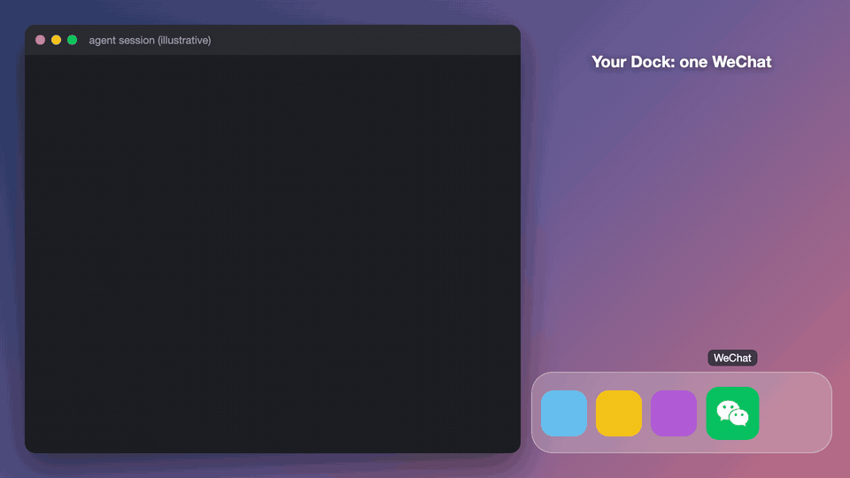

# wechat-multifix — macOS 微信双开 / 多开

[English](README.md) · **中文**

**一条命令（或对 AI Agent 说一句话）把微信复制成第二个应用，带独立配色图标，一眼分清账号。**

<p align="center">
  
</p>

<p align="center">
   &nbsp;
   &nbsp;
   &nbsp;
   &nbsp;
   &nbsp;
  
</p>

> **非官方，风险自担。** 本工具会在本机复制 `/Applications/WeChat.app` 并对副本做临时（ad-hoc）重新签名。它不是腾讯出品或认可的工具，微信更新后可能失效。

## 亮点

- **一步装好第二个微信**：复制、改 Bundle ID、重新签名、换图标。
- **6 种配色图标**（黑、青、紫、橙、深蓝、深灰），原版保持绿色。
- **微信更新后一句话修复**：对 Agent 说「修复微信多开」，聊天记录保留。
- **不止双开**：同样的方法可以做出 WeChat3、WeChat4……
- **可当 Agent 技能用**（Claude Code、Codex、Openclaw、Hermes 等），也可以完全手动。

## 安装

最省事：把下面这段 prompt 完整复制给 AI Agent。

```
帮我安装 macOS 微信双开工具。

步骤：
1. 读取这个 Skill 的 SKILL.md 文件，路径在当前目录的 .agents/skills/wechat-multifix/SKILL.md
2. 按照 SKILL.md 中的流程执行安装

安装前，Agent 会自动询问你想要哪种配色（黑/青/紫/橙/深蓝/深灰），你只需要回复数字或配色名即可。

完成后告诉我：
- WeChat 和 WeChat2 的 Bundle ID 分别是什么？
- 两者是否不同？
```

或者手动安装（这里用黑色图标，可换成 `skills/wechat-multifix/icons/` 里的其他文件）：

```bash
SKILL_DIR="$PWD/skills/wechat-multifix"   # 在仓库根目录运行
ICON="AppIcon-black.icns"

cp -R /Applications/WeChat.app /Applications/WeChat2.app
/usr/libexec/PlistBuddy -c "Set :CFBundleIdentifier com.tencent.xinWeChat2" /Applications/WeChat2.app/Contents/Info.plist
/usr/libexec/PlistBuddy -c "Set :CFBundleName WeChat2" /Applications/WeChat2.app/Contents/Info.plist
xattr -cr /Applications/WeChat2.app
codesign --force --deep --sign - /Applications/WeChat2.app
chown -R $(whoami):admin /Applications/WeChat2.app
cp "$SKILL_DIR/icons/$ICON" /Applications/WeChat2.app/Contents/Resources/AppIcon.icns
codesign --force --deep --sign - /Applications/WeChat2.app
open -a /Applications/WeChat2.app
```

## 在 Claude Code / Codex 中使用

```bash
npx skills add risingjerry/wechat-multifix
```

也可以把 `skills/wechat-multifix` 复制到 `~/.claude/skills/`（Claude Code）或 `~/.agents/skills/`（Codex 等兼容 Agent）。然后直接说：

- `安装微信双开，我要紫色图标`
- `修复微信多开`（微信更新后用）
- `再给我做一个橙色图标的第三个微信`

动手前 Agent 会先问你要哪种配色。

## 6 种内置图标

| 配色 | 图标文件名 | 主题感 |
|---|---|---|
| 黑底 | `AppIcon-black.icns` | 低调、暗黑模式首选 |
| 青底 | `AppIcon-cyan.icns` | 清新、科技感 |
| 紫底 | `AppIcon-purple.icns` | 优雅、创意 |
| 橙底 | `AppIcon-orange.icns` | 活力、温暖 |
| 深蓝底 | `AppIcon-navy.icns` | 沉稳、商务 |
| 深灰底 | `AppIcon-darkgray.icns` | 低调、简洁 |

原版 `WeChat.app` 保持绿底白标。

## 工作原理

macOS 用 Bundle ID 区分应用，直接复制的微信会和原版冲突。本工具给副本换成独立的 Bundle ID（`com.tencent.xinWeChat2`），清除扩展属性，做 ad-hoc 重新签名，再换图标。副本的数据存放在 `~/Library/Containers/com.tencent.xinWeChat2/`，与应用本体分离，所以修复不会丢聊天记录。

## 限制与要求

- 需要 macOS，且已安装 `/Applications/WeChat.app`；命令需要有写入 `/Applications` 的权限。
- **微信更新会覆盖 `WeChat2.app`**，并把它的 Bundle ID 重置成和原版相同，之后两个都打不开。按下面的方法修复即可。也可以在「系统设置 → 通用 → 自动更新」里关掉微信自动更新，需要时手动修复。
- 副本由本机重新签名，不是腾讯签名。非官方，风险自担。
- 通知权限需要手动开启（见常见问题）。

## 常见问题

### macOS 怎么同时登录两个微信？
装好本工具、选一种配色，然后分别打开 `WeChat` 和 `WeChat2`，各登录一个账号。一起打开可以用：`open -a /Applications/WeChat.app; sleep 0.5; open -a /Applications/WeChat2.app`。

### 微信更新后 WeChat2 打不开了怎么办？
更新会重置 WeChat2 的 Bundle ID，macOS 就把两个当成同一个应用。对 Agent 说「修复微信多开」，或重新运行安装命令，会重建 WeChat2 并恢复图标。聊天记录存在应用外部，不受影响。

### 会丢聊天记录吗？
修复不会。记录在 `~/Library/Containers/com.tencent.xinWeChat2/`，只有卸载时删除这个文件夹才会清掉，且无法恢复。

### 提示「应用已损坏」或打不开？
第一次请右键 `WeChat2.app`，选择「打开」。

### WeChat2 没有 Dock 红点和通知？
要开两处：WeChat2 内的「设置 → 通知」（新消息通知、声音、消息预览），以及 macOS「系统设置 → 通知 → WeChat2」。副本首次启动时 macOS 往往不会弹授权提示。

### 怎么做第三个、第四个微信？
用技能里的「多开」配方：改编号，例如 `WeChat3`、Bundle ID `com.tencent.xinWeChat3`，再选一个别的图标。

## 卸载

```bash
rm -rf /Applications/WeChat2.app
rm -rf ~/Library/Containers/com.tencent.xinWeChat2   # 该账号的聊天记录，不可恢复
```

如果做过 `WeChat3`、`WeChat4`……同样处理。原版 `WeChat.app` 不会被改动。

## 许可证

MIT。WeChat 是腾讯的商标，本项目与腾讯无关。

---

如果它帮你省下了一部手机，点个 star 能让更多人找到它。

[](https://star-history.com/#risingjerry/wechat-multifix&Date)
